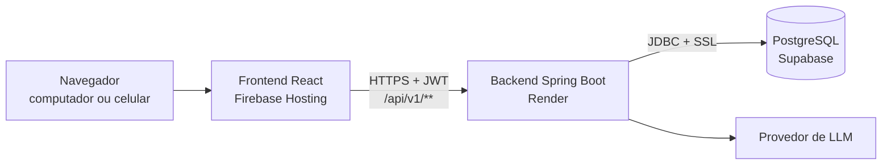
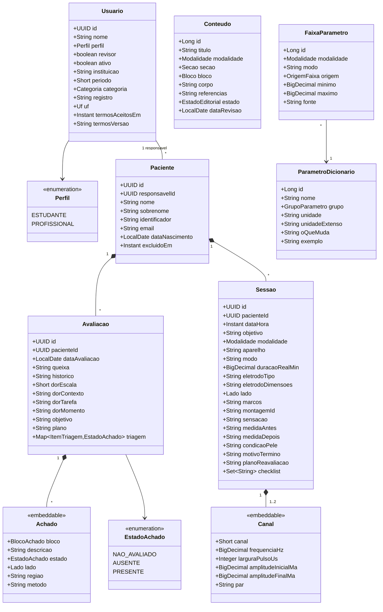
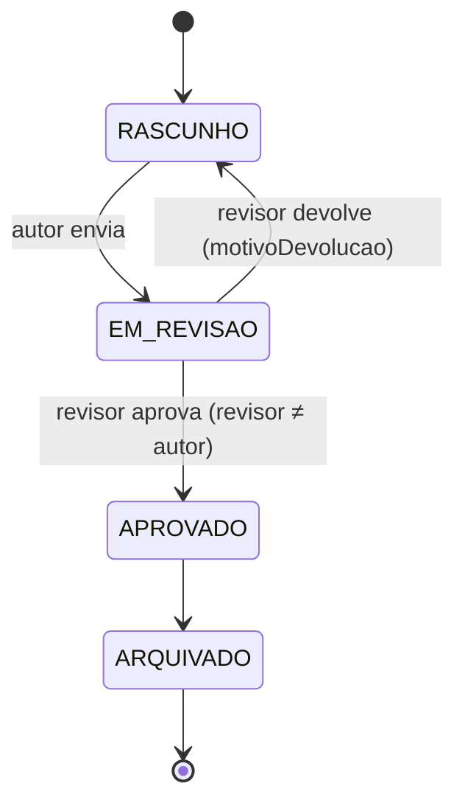
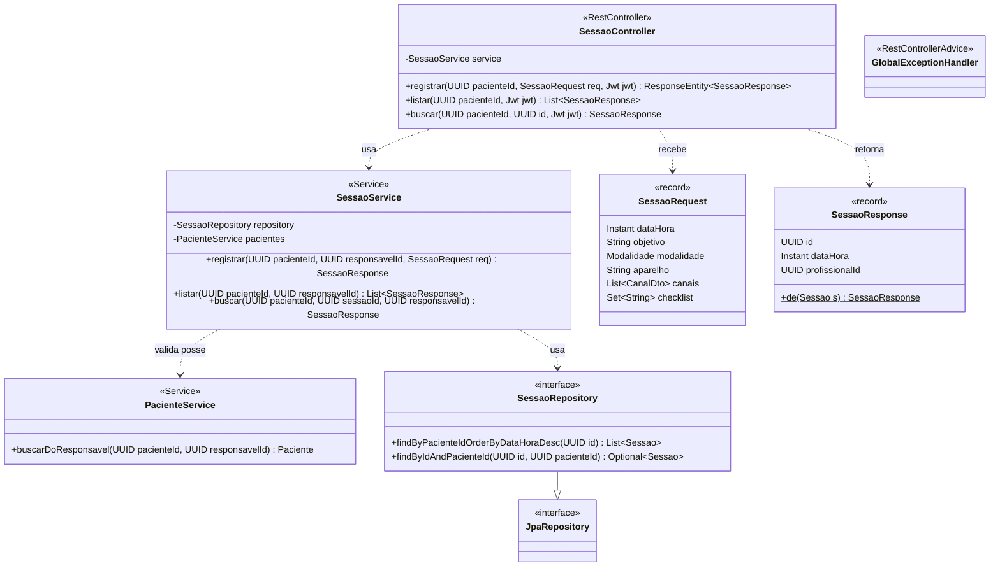
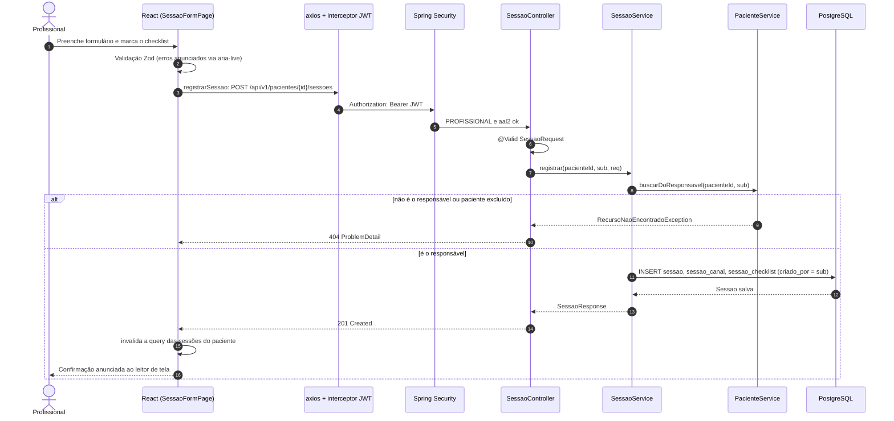
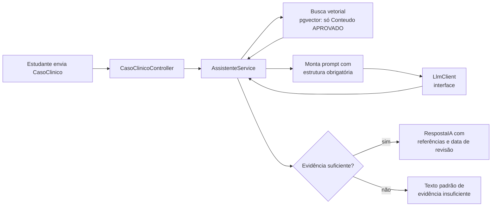
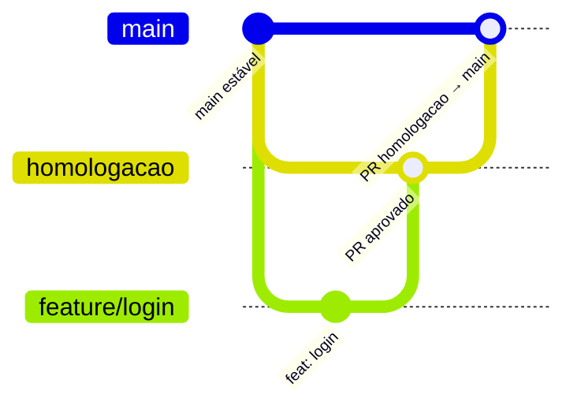

# Fisiotech — Backend (API)

API REST da plataforma educacional e clínica de eletroestimulação **Fisiotech** (TENS, NMES e FES). Este repositório tem duas pastas:

- `backend/` (este documento): API em Java 25 + Spring Boot.
- `frontend/`: SPA em React + TypeScript. Veja `../frontend/README.md`.

O backend é a **única** porta de acesso ao banco. Toda regra de negócio e toda regra de acesso ficam aqui. O frontend só esconde a interface.

Documentos de origem (fora deste repositório, pasta `docs/` do projeto): `Prototipo_TENS_FES_Revisado.md`, `Guia_Tecnico_Implementacao_TENS_FES.md`, `uml_e_arquitetura_do_sistema_front_end_back_end.md` e `trello_cards.md`.

---

## Sumário

1. [Stack](#1-stack)
2. [Pré-requisitos](#2-pré-requisitos)
3. [Como rodar localmente](#3-como-rodar-localmente)
4. [Variáveis de ambiente](#4-variáveis-de-ambiente)
5. [Banco de dados (Supabase)](#5-banco-de-dados-supabase)
6. [Comandos](#6-comandos)
7. [Arquitetura](#7-arquitetura)
8. [Estrutura de pastas](#8-estrutura-de-pastas)
9. [Perfis e regras de acesso](#9-perfis-e-regras-de-acesso)
10. [UML — domínio](#10-uml--domínio)
11. [UML — camadas (feature Sessão)](#11-uml--camadas-feature-sessão)
12. [UML — sequência: registrar sessão](#12-uml--sequência-registrar-sessão)
13. [Módulo de IA (RAG)](#13-módulo-de-ia-rag)
14. [Convenções de código](#14-convenções-de-código)
15. [Testes](#15-testes)
16. [Branches, commits e Pull Requests](#16-branches-commits-e-pull-requests)
17. [Deploy](#17-deploy)
18. [Estado atual e pendências](#18-estado-atual-e-pendências)

---

## 1. Stack

| Camada | Tecnologia | Motivo |
|---|---|---|
| Linguagem | Java 25 | Versão LTS |
| Framework | Spring Boot 4.1.1 | Suporte oficial a Java 25 |
| HTTP | Spring Web MVC | API REST |
| Segurança | Spring Security + JWT | Perfis e posse do paciente |
| Persistência | Spring Data JPA (Hibernate) | Repositórios gerados pelo Spring |
| Migrations | Flyway | Schema versionado em SQL |
| Validação | Bean Validation (`@Valid`) | Valida o DTO na entrada |
| Auditoria | Spring Data Auditing (`@CreatedBy`, `@LastModifiedBy`) | Registro clínico guarda quem criou e quem alterou. Envers não foi adotado (sem histórico campo a campo; `decisoes.md`, 2026-10-16) |
| Banco | PostgreSQL 17 no **Supabase** | Relacional; `unaccent` para busca sem acento e `pg_cron` para a limpeza de pacientes excluídos |
| Busca | Full-text do PostgreSQL (`tsvector` + `unaccent`) | Busca de paciente por nome ou identificador, por prefixo |
| IA | pgvector *(a adicionar)* | Busca vetorial no mesmo banco |
| Contrato | springdoc-openapi 3.1.1 | Swagger UI; gera os tipos TypeScript do frontend |
| IA | Spring AI *(a adicionar)* | RAG sobre conteúdo revisado |
| Erros | `ProblemDetail` (RFC 9457) | Formato único de erro |
| Observabilidade | Spring Boot Actuator | `/actuator/health` |
| Testes | JUnit 5, Mockito, Testcontainers (PostgreSQL 17) | Integração com banco real |
| Build | Maven (wrapper `mvnw`) | Ninguém precisa instalar Maven |
| Deploy | Render (Docker, plano grátis) | CI no GitHub Actions em todo PR. Guia em [DEPLOY.md](../DEPLOY.md) |

Itens *(a adicionar)* entram junto com a feature que os usa. Não adicione dependência sem uso.

---

## 2. Pré-requisitos

| Ferramenta | Versão | Observação |
|---|---|---|
| JDK | **25** | Temurin recomendado. `JAVA_HOME` precisa apontar para o JDK 25 |
| Docker | qualquer recente | Só para os testes de integração (Testcontainers) |
| Git | qualquer | |
| Maven | não precisa | Use `./mvnw` (Linux/macOS/Git Bash) ou `.\mvnw.cmd` (PowerShell) |

Confira o Java:

```powershell
java -version          # deve mostrar 25
echo $env:JAVA_HOME    # deve apontar para o JDK 25
```

**Armadilha comum:** com o JDK 21 e o 25 instalados, o `JAVA_HOME` pode ficar no 21. O build falha com:

```
Fatal error compiling: error: release version 25 not supported
```

Correção na sessão atual do PowerShell:

```powershell
$env:JAVA_HOME = "C:\Program Files\Eclipse Adoptium\jdk-25.0.4.101-hotspot"
```

Para corrigir de vez, altere `JAVA_HOME` nas variáveis de ambiente do Windows.

---

## 3. Como rodar localmente

```powershell
git clone git@github.com:eksdat/tens-fes-web.git
cd tens-fes-web
git switch homologacao
cd backend

copy .env.example .env      # preencha com os dados do Supabase (seção 5)
```

O `application.yml` importa o `backend/.env` (`spring.config.import: optional:file:.env[.properties]`). Basta rodar a partir da pasta `backend/`:

```powershell
.\mvnw.cmd spring-boot:run
```

O caminho é relativo à pasta de onde o comando roda. Rodando de outra pasta (ou no IntelliJ com outro *Working directory*), o `.env` não é lido e a aplicação falha com `'url' must start with "jdbc"`. Variáveis de ambiente do sistema têm prioridade sobre o `.env`.

Confira se subiu:

| URL | Esperado |
|---|---|
| http://localhost:8080/actuator/health | `{"status":"UP"}` |
| http://localhost:8080/swagger-ui.html | Swagger UI (só com `SWAGGER_ENABLED=true` no `.env`) |
| http://localhost:8080/v3/api-docs | Contrato OpenAPI em JSON |

### Rodar sem Supabase (banco local em Docker)

A classe de teste `TestFisiotechApiApplication` sobe a API com um PostgreSQL 17 em container. Ela não precisa de `.env`:

```powershell
.\mvnw.cmd spring-boot:test-run
```

Use para desenvolver offline. Os dados somem ao parar.

### Rodar com o Supabase local (Auth + banco)

Para testar login e cadastro de ponta a ponta sem tocar na nuvem. Precisa de Docker. Na raiz do repositório:

```powershell
npx supabase start                  # sobe Postgres, Auth e Mailpit (a primeira vez baixa as imagens)
cd backend
.\mvnw.cmd spring-boot:run "-Dspring-boot.run.profiles=local"
```

O perfil `local` (`application-local.yml`) aponta para o banco `127.0.0.1:54322` e valida os tokens do Auth local. Não usa o `.env`. O Flyway cria as tabelas na primeira subida e aplica as migrations novas a cada reinício. Login falhando com `{"message":"name resolution failed"}`: o contêiner do Auth está parado (confira com `docker ps`); rode `npx supabase stop` e `npx supabase start` (os dados ficam). Os e-mails saem pelo SMTP real: preencha `supabase/.env` antes (modelo em `supabase/.env.example`). Com o SMTP desligado no `config.toml`, abra o Mailpit em http://127.0.0.1:54324. O painel (Studio) fica em http://127.0.0.1:54323. `npx supabase stop` desliga tudo; os dados ficam guardados para a próxima vez. A configuração do Auth local (`supabase/config.toml`) repete a política da nuvem: senha de 10 caracteres com maiúscula, minúscula, número e símbolo, confirmação por e-mail e templates em português.

---

## 4. Variáveis de ambiente

Todas ficam em `.env` (local) ou no painel do Render (produção). O arquivo `.env` está no `.gitignore`. **Nunca** faça commit de senha.

| Variável | Obrigatória | Exemplo | Uso |
|---|---|---|---|
| `DB_URL` | sim | `jdbc:postgresql://aws-0-sa-east-1.pooler.supabase.com:5432/postgres?sslmode=require` | JDBC do Supabase |
| `DB_USERNAME` | sim | `postgres.<project-ref>` | Usuário do pooler |
| `DB_PASSWORD` | sim | — | Senha do banco |
| `CORS_ALLOWED_ORIGINS` | não | `http://localhost:5173` | Origens do frontend, separadas por vírgula |
| `SWAGGER_ENABLED` | não | `true` | Liga o Swagger (`/swagger-ui.html`, `/v3/api-docs`). **Só em desenvolvimento**: sem a variável, a documentação não existe (padrão de produção) |

O mapeamento está em `src/main/resources/application.yml`.

---

## 5. Banco de dados (Supabase)

**Decisão:** o Supabase é o PostgreSQL gerenciado e o serviço de identidade (Supabase Auth: cadastro, login, e-mail, senha, MFA). Perfis e regras de acesso ficam no Spring Boot.

- O frontend usa só `supabase.auth.*`. A API automática do Supabase (Data API/PostgREST) fica desligada e sem permissão.
- Motivo: a regra "profissional só vê o próprio paciente" fica num lugar só. Em dois lugares, um deles acaba esquecido e vira vazamento de prontuário. Detalhes em [SEGURANCA.md](../SEGURANCA.md).

Como pegar a conexão:

1. Supabase › *Project Settings* › *Database* › *Connection string*.
2. Escolha **Session pooler** (funciona em rede IPv4; a conexão direta exige IPv6).
3. Copie host, porta, usuário e senha para o `.env`. Mantenha `?sslmode=require`.

### Migrations (Flyway)

- Ficam em `src/main/resources/db/migration/`.
- Nome: `V<n>__<descricao>.sql`. Ex.: `V8__paciente.sql`.
- Rodam sozinhas ao subir a aplicação.
- **Nunca** edite uma migration que já foi aplicada em produção. Crie uma nova.
- `spring.jpa.hibernate.ddl-auto=validate`: o Hibernate **não** cria tabela. Ele só confere se a entidade bate com o schema. Se não bater, a aplicação não sobe. Isso é proposital.
- Nunca altere o schema pelo painel do Supabase. Toda mudança passa por migration.
- O Supabase cria a function `public.rls_auto_enable`, que liga o RLS em toda tabela nova. Por causa dela o Flyway vê o schema como "não vazio" e falha com `Found non-empty schema(s) "public" but no schema history table`. Por isso o `application.yml` usa `baseline-on-migrate: true` com `baseline-version: 0`: o histórico começa na versão 0 e a `V1` continua sendo aplicada. Não suba `baseline-version` para 1, senão a `V1` é pulada.
- O RLS ligado não afeta o backend: o usuário `postgres` é dono das tabelas e passa pelo RLS. Ele bloqueia o acesso pela Data API do Supabase, que é o que queremos.
- As migrations usam os papéis `anon` e `authenticated`, que só existem no Supabase. Num PostgreSQL comum a `V1` falha com `role "anon" does not exist`. Os testes criam esses papéis antes das migrations (`src/test/resources/papeis-supabase.sql`, carregado em `TestcontainersConfiguration`). Fora do Supabase, crie os dois papéis antes de subir a API.
- A `V8` cria as extensões `unaccent` (no schema `extensions`) e `pg_cron`. O `pg_cron` só existe no Supabase: no PostgreSQL dos testes o agendamento é pulado (`do $$ ... if exists (pg_available_extensions)`).
- Em branches paralelas, o número da migration é definido na hora do merge (o próximo livre). Duas branches com a mesma versão quebram o Flyway.

| Versão | O que faz |
|---|---|
| `V1__seguranca_base` | Revoga tudo de `anon` e `authenticated`, inclusive para objetos futuros |
| `V2__usuario` | Tabela `usuario` com `CHECK` por perfil |
| `V3__aceite_termos` | Data e versão dos termos aceitos |
| `V4__parametro_dicionario` | Dicionário de parâmetros (seção 12 do guia) |
| `V5__conteudo` | Conteúdo técnico de TENS e FES, todo `EM_REVISAO` |
| `V6__conteudo_bloco` | Coluna `bloco` (página técnica padrão) e blocos que faltavam |
| `V7__faixa_parametro` | Parâmetro "Platô" e faixas educativas e do aparelho por modo (25 linhas) |
| `V8__paciente` | `paciente`, função `sem_acento`, busca full-text, `unaccent` e job `pg_cron` de 90 dias |
| `V9__avaliacao` | `avaliacao`, `avaliacao_triagem`, `avaliacao_achado` |
| `V10__sessao` | `sessao`, `sessao_canal`, `sessao_checklist` |
| `V11__paciente_sem_telefone` | Remove o telefone do paciente (minimização) |
| `V12__sessao_checklist_codigo` | Itens do checklist da sessão passam a código fixo |

Tabelas, colunas e índices: `agent_docs/database.md` no vault do projeto.

---

## 6. Comandos

| Comando (PowerShell) | O que faz |
|---|---|
| `.\mvnw.cmd spring-boot:run` | Sobe a API em `:8080` usando o Supabase |
| `.\mvnw.cmd spring-boot:test-run` | Sobe a API com PostgreSQL em Docker |
| `.\mvnw.cmd test` | Roda todos os testes (precisa de Docker) |
| `.\mvnw.cmd -DskipTests package` | Gera `target/fisiotech-api-0.0.1-SNAPSHOT.jar` |
| `java -jar target/fisiotech-api-0.0.1-SNAPSHOT.jar` | Roda o jar gerado |

---

## 7. Arquitetura

Visão do sistema inteiro:



Plataforma: uma versão web responsiva. Não há aplicativo nativo.

### Pacote por feature, camadas dentro da feature

Cada feature (`paciente`, `sessao`, ...) tem as próprias camadas:

| Camada | Anotação | Responsabilidade | Não pode |
|---|---|---|---|
| Controller | `@RestController` | Entrada HTTP. Valida o DTO com `@Valid`. Devolve `ResponseEntity` | Ter regra de negócio |
| Service | `@Service` | Regra de negócio, autorização por posse, `@Transactional`, conversão entidade ↔ DTO | Conhecer HTTP |
| Repository | `interface XRepository extends JpaRepository<X, ID>` | Acesso ao banco. O Spring gera a implementação | Ter regra |
| Entity | `@Entity` | Mapeamento JPA | Sair do backend |
| DTO | `record` | Contrato da API (`XRequest`, `XResponse`). A conversão fica no próprio DTO (`XResponse.de(entidade)`); não há classe Mapper | — |
| Enum | `enum` | Constantes do domínio | — |

Regras de desenho:

- **A entidade nunca sai do backend.** Sempre DTO.
- **Não criar `IXService`** com uma implementação só. O Mockito mocka a classe concreta. Interface só existe com mais de uma implementação real ou quando o teste precisa de um fake. Caso previsto: `LlmClient` (seção 13).
- Erro sai como `ProblemDetail` (`shared/exception/GlobalExceptionHandler`). Exceções de domínio estendem `ErrorResponseException` e já levam o status: `RecursoNaoEncontradoException` (404), `ConflitoException` (409) e `DadoInvalidoException` (400 com `erros: { campo: mensagem }`, para regra que depende do banco, como data da avaliação antes do nascimento). Erro de validação do DTO traz o mesmo `erros`. Erro do framework sai com "Requisição inválida." e exceção não tratada com 500 "Erro interno." (detalhe só no log). Exceção nova de domínio que deva manter a própria mensagem precisa entrar na exceção do `handleExceptionInternal`.
- Rotas da API: prefixo `/api/v1`. Ex.: `POST /api/v1/pacientes/{id}/sessoes`.

### Endpoints

| Método e rota | Quem | O que faz |
|---|---|---|
| `GET /usuarios/me` | autenticado | Usuário logado; 404 sem cadastro. Traz `termosPendentes` |
| `POST /usuarios/me` | autenticado | Completa o cadastro (exige `aceiteTermos`) |
| `PUT /usuarios/me/perfil` | autenticado | Estudante passa a profissional |
| `POST /usuarios/me/termos` | autenticado | Novo aceite quando a versão dos termos muda |
| `GET /conteudos?modalidade=` | com perfil | Conteúdos `APROVADO` |
| `GET /conteudos/pagina?modalidade=&secao=` | com perfil | Página técnica padrão: blocos na ordem, `liberada` |
| `GET /conteudos/{id}` | com perfil | Um conteúdo aprovado |
| `GET /parametros?busca=` | com perfil | Dicionário de parâmetros |
| `GET /parametros/faixas?modalidade=` | com perfil | Faixas educativas e do aparelho por modo |
| `GET /pacientes?busca=&ordenar=&direcao=&pagina=&tamanho=` | PROFISSIONAL + aal2 | Pacientes do responsável, paginados |
| `POST`, `GET /{id}`, `PUT /{id}`, `DELETE /{id}` em `/pacientes` | PROFISSIONAL + aal2 | Cadastro, leitura, edição e exclusão lógica |
| `GET`, `POST`, `GET /{id}`, `PUT /{id}` em `/pacientes/{id}/avaliacoes` | PROFISSIONAL + aal2 | Avaliação inicial (várias por paciente) |
| `GET`, `POST`, `GET /{id}` em `/pacientes/{id}/sessoes` | PROFISSIONAL + aal2 | Registro de sessão (sem edição: registro clínico) |

Regras de cada módulo (campos, validações, erros comuns): `agent_docs/modulos/` no vault do projeto.

### Segurança (`config/SecurityConfig.java`)

- API **stateless**: sem sessão HTTP, então sem CSRF.
- Liberados sem login: `/actuator/health/**`. O Swagger (`/swagger-ui/**`, `/v3/api-docs/**`) também passa pela segurança, mas só existe com `SWAGGER_ENABLED=true`.
- Todo o resto exige autenticação.
- `@EnableMethodSecurity` ativa `@PreAuthorize` nos controllers.
- `/api/v1/pacientes/**` exige `PROFISSIONAL` **e** sessão `aal2` (MFA) no token (`SESSAO_COM_MFA`); sem MFA, 403.
- `AuditoriaConfig` preenche `criado_por` e `alterado_por` com o `sub` do token.
- CORS liberado só para `/api/**` e para as origens de `CORS_ALLOWED_ORIGINS`.
- O JWT é validado pelo resource server do Spring (chaves públicas do Supabase); o perfil vem do banco (`PerfilJwtConverter`).

---

## 8. Estrutura de pastas

```text
backend/
├── pom.xml
├── mvnw, mvnw.cmd, .mvn/          # Maven wrapper
├── .env.example                   # modelo das variáveis (copie para .env)
└── src/
    ├── main/
    │   ├── java/br/unibh/fisiotech/
    │   │   ├── FisiotechApiApplication.java
    │   │   ├── config/        # SecurityConfig (JWT, CORS, aal2), AuditoriaConfig, ResumoInicializacao
    │   │   ├── shared/
    │   │   │   ├── dto/       # PaginaResponse
    │   │   │   └── exception/ # GlobalExceptionHandler, RecursoNaoEncontrado, Conflito, DadoInvalido
    │   │   ├── usuario/       # cadastro, perfil e aceite dos termos (identidade no Supabase Auth)
    │   │   │   ├── controller/  service/  repository/  entity/  dto/  enums/
    │   │   │   └── security/  # PerfilJwtConverter (JWT -> papéis, perfil vem do banco)
    │   │   ├── conteudo/      # Conteudo e página técnica padrão (Modalidade, Secao, Bloco, EstadoEditorial)
    │   │   ├── parametro/     # ParametroDicionario e FaixaParametro (faixas por modo)
    │   │   ├── paciente/      # Paciente: busca, ordenação, paginação, exclusão lógica
    │   │   ├── avaliacao/     # Avaliacao, triagem e achados (EstadoAchado, ItemTriagem, Lado)
    │   │   └── sessao/        # Sessao, Canal e checklist
    │   └── resources/
    │       ├── application.yml, application-local.yml
    │       └── db/migration/  # V1 a V12 (seção 5)
    └── test/
        ├── java/br/unibh/fisiotech/   # espelha os pacotes de main (seção 15)
        └── resources/papeis-supabase.sql
```

Toda feature segue o mesmo padrão de subpastas: `controller/`, `service/`, `repository/`, `entity/`, `dto/`, `enums/` e, quando houver, `security/`. Crie só a subpasta que tiver classe. Aparelho, atlas, simulador e casos ainda não têm backend: o frontend usa dados estáticos (`frontend/README.md`). Assistente de IA e materiais com anexo não existem ainda.

Consequência do padrão: o que uma camada usa de outra precisa ser `public` (ex.: `Usuario.definirDadosEstudante`). Mutação sensível que só teste usa (ex.: `revisor`, `ativo`) não ganha setter; o teste usa `ReflectionTestUtils`.

---

## 9. Perfis e regras de acesso

| Área | Estudante | Profissional |
|---|---|---|
| Conteúdos TENS/FES, biblioteca, atlas, aparelho | Consulta | Consulta |
| Simulador e casos fictícios | Acesso | Acesso |
| Criar materiais | Rascunho e envio | Contribuição para revisão |
| Pacientes / prontuário | **Sem acesso** | **Só os pacientes sob sua responsabilidade** |
| Casos para a IA | Envia caso fictício | Conteúdo revisado alimenta a base |

Regras obrigatórias no backend:

1. Endpoint de paciente exige `PROFISSIONAL` (`@PreAuthorize("hasRole('PROFISSIONAL')")`). `ESTUDANTE` recebe **403**. A `SecurityConfig` também barra `/api/v1/pacientes/**` (pacientes, avaliações e sessões) para quem não é `PROFISSIONAL` **ou** não tem sessão `aal2` (MFA), então um endpoint novo nasce protegido mesmo se faltar o `@PreAuthorize`.
2. Todo acesso a paciente, avaliação ou sessão confere `paciente.responsavelId == sub do token`. Se falhar, responde **404**, não 403. Assim não revela que o registro existe. O ponto único dessa verificação é `PacienteService.buscarDoResponsavel` (`findByIdAndResponsavelId`).
3. Paciente não é usuário: sem login, sem conta.
4. Registro profissional digitado (CREFITO etc.) **não** gera selo de "verificado".
5. Só usuário com `revisor = true` (PROFISSIONAL) aprova material, e nunca o próprio. `revisor` não muda por endpoint: liga-se no banco para pessoas conhecidas (docente).
6. `Anexo`: só PDF e imagem, até 10 MB.
7. Senha, e-mail, redefinição de senha e MFA ficam no Supabase Auth. Nossa tabela `usuario` não guarda e-mail nem senha. Perfil nunca no `user_metadata`. Regras de campo e validações em [SEGURANCA.md](../SEGURANCA.md) e no "Cadastro" abaixo.
8. Até as políticas LGPD estarem definidas: **somente dados fictícios**.

### Cadastro (tabela `usuario`, migrations `V2__usuario.sql` e `V3__aceite_termos.sql`)

Dois perfis: `ESTUDANTE` e `PROFISSIONAL`. Paciente não é usuário. Docente é `PROFISSIONAL` com `revisor = true`. Uma tabela só, com colunas opcionais por perfil; o banco exige os campos de cada perfil por `CHECK`.

| Campo | Perfil | Regra |
|---|---|---|
| `nome` | ambos | 2 a 120 caracteres |
| `termos_aceitos_em`, `termos_versao` | ambos | O `POST` exige `aceiteTermos: true` (400 sem ele). A API grava a data e a versão vigente (`Usuario.VERSAO_TERMOS`). Nulos só em cadastros anteriores à V3. Mudou o texto de `/termos` ou `/privacidade`: troque a versão; `GET /me` passa a devolver `termosPendentes: true` e o frontend pede novo aceite (`POST /me/termos`) |
| `instituicao` | estudante | Texto livre. A tela sugere UniBH, PUC Minas, UFMG, Unifenas |
| `periodo` | estudante | 1 a 12 |
| `categoria` | profissional | `FISIOTERAPEUTA`, `TERAPEUTA_OCUPACIONAL`, `OUTRA` |
| `registro` | profissional | Formato: `123456-F` (fisioterapeuta), `123456-TO` (terapeuta ocupacional); livre até 20 para `OUTRA`. Sem consulta ao CREFITO, sem selo de "verificado" |
| `uf` | profissional | Uma das 27 siglas |

- O curso não é guardado: o sistema é só para Fisioterapia.
- Troca ESTUDANTE → PROFISSIONAL: os dados de estudante continuam gravados como histórico. O inverso não existe.
- Anti-spam no texto livre (`nome`, `instituicao`, `registro`): `trim`, tamanho máximo, sem URL (`http`, `www.`), sem caractere de controle; só letras, números, espaço e `. - ' ( ) /`. Validado no DTO (`@Pattern`, `@Size`).
- Anti-spam no cadastro: confirmação de e-mail obrigatória e limite de cadastros por IP no Supabase Auth; CAPTCHA (Cloudflare Turnstile, gratuito) no formulário de cadastro, configurado em *Authentication › Attack Protection*.

---

## 10. UML — domínio

O que existe no código:



Notas que o diagrama não mostra:

- Todo id de tabela clínica é `UUID`. `Paciente`, `Avaliacao` e `Sessao` guardam `criadoEm`, `criadoPor`, `alteradoEm` e `alteradoPor` (Spring Data Auditing; `config/AuditoriaConfig`). Não há histórico campo a campo.
- Triagem e achados usam `EstadoAchado`. **Campo vazio não significa ausência de risco.** Item omitido vira `NAO_AVALIADO`; `dorEscala` nula é "não avaliada".
- `Paciente` tem exclusão lógica (`excluidoEm` + `@SQLRestriction`). O job `pg_cron` apaga de vez após 90 dias, com avaliações e sessões em cascata.
- `Sessao` não tem edição. O profissional da sessão é o `criadoPor`.
- `Canal` tem a unidade no nome do campo (`frequenciaHz`, `larguraPulsoUs`, `amplitudeInicialMa`).
- `ParametroDicionario` (texto do dicionário) ≠ `Canal` (valor usado numa sessão real) ≠ `FaixaParametro` (faixa educativa ou do aparelho por modo).

Planejado, sem código ainda: `Aparelho` e `Controle`, `PranchaAtlas`, `CasoPratica` e `TentativaPratica` (simulador com casos), `CasoClinico` e `RespostaIA` (assistente), `Material`, `Anexo` e `Referencia` (fluxo editorial). Regras já decididas para eles:

- `RespostaIA` cita só `Conteudo` `APROVADO`. `CasoClinico` e anexos **nunca** entram na base da IA automaticamente.
- `CasoPratica` = os casos fictícios do simulador. `CasoClinico` = caso que o estudante envia para a IA.
- `Material` é criado por usuário. Aprovado, vira `Conteudo` publicado.

Fluxo editorial de `Material`/`Conteudo` (hoje o `Conteudo` só muda de estado direto no banco):



---

## 11. UML — camadas (feature Sessão)

Modelo que toda feature segue:



---

## 12. UML — sequência: registrar sessão



---

## 13. Módulo de IA (RAG)



Regras:

- A resposta segue 7 passos: objetivo, o que falta, conceitos, comparação, riscos, referências com data e pergunta de aprendizagem.
- Texto de caso ou anexo entra como **dado**, nunca como instrução. Instrução escondida num anexo não muda regra nem acesso (proteção contra prompt injection).
- Prontuário não é indexado. O indexador lê só `conteudo` com `estado = APROVADO`.
- `LlmClient` é interface: troca de provedor e fake nos testes.

---

## 14. Convenções de código

- Código, nomes de classe e de campo em **português** do domínio (`Paciente`, `buscarDoResponsavel`). Termos técnicos do framework ficam como são (`Controller`, `Repository`).
- Comentário só explica **por quê**. Nada de comentário que repete o código, código comentado ou `TODO` sem dono.
- Solução mais simples que resolve o problema de hoje. Sem abstração "para o futuro".
- DTO é `record`. Entidade nunca é serializada.
- Unidade física no nome do campo (`Hz`, `Us`, `Ma`).
- Datas: `LocalDate`/`LocalDateTime`. Dinheiro e medidas com casa decimal: `BigDecimal`.

---

## 15. Testes

| Tipo | Ferramenta | O que cobre |
|---|---|---|
| Unitário | JUnit 5 + Mockito | Regra de negócio no Service |
| Integração | `@SpringBootTest` + Testcontainers (PostgreSQL 17) | Controller → banco real, migrations, segurança |
| Segurança | `spring-security-test` | 401 sem token, 403 para estudante e sem MFA, 404 para paciente de outro profissional |

Estado: 135 testes, todos verdes (`.\mvnw.cmd test`, 2026-10-16). Uma classe de integração por feature (`*IntegracaoTest`) sobe o contexto com PostgreSQL 17 e roda as migrations:

| Classe | Cobre |
|---|---|
| `PacienteIntegracaoTest` | CRUD, busca sem acento e por prefixo, ordenação, paginação, identificador único por responsável, exclusão lógica, 404 entre profissionais, 403 sem `aal2` |
| `AvaliacaoIntegracaoTest` | Validações (queixa, objetivo, data antes do nascimento e de 1900, dor 0 a 10 com tarefa e momento), triagem e achado omitidos como `NAO_AVALIADO`, achado com lado, região e método, 404 entre profissionais |
| `SessaoIntegracaoTest` | Blocos obrigatórios, canal repetido, limite físico dos parâmetros, checklist só por código, ordem da lista, 404 entre profissionais |
| `UsuarioIntegracaoTest` | Cadastro, 409, `CHECK` do banco, troca para profissional, aceite e versão dos termos, 403 sem cadastro ou inativo |
| `ConteudoIntegracaoTest`, `ParametroDicionarioIntegracaoTest`, `FaixaParametroIntegracaoTest` | Seeds, só `APROVADO`, página técnica, faixas por modo |
| `RestricaoPorPerfilTest`, `RestricaoPorPerfilIntegracaoTest` | 401, 403 por perfil e sem MFA |
| `SwaggerIntegracaoTest` | Swagger desligado por padrão |
| Unitários (`*ServiceTest`, `*ControllerTest`, `PerfilJwtConverterTest`, `CadastroRequestTest`, `GlobalExceptionHandlerTest`) | Regras sem banco e formato dos erros |

Regras:

- **TDD**: bug novo começa com teste que reproduz o bug e falha. Regra de negócio nova começa pelo teste.
- Nome do teste descreve o comportamento: `deveResponder404QuandoPacienteEDeOutroProfissional`.
- Um comportamento por teste. Sem `if`/`for` no teste.
- Sem dependência de ordem, relógio real ou rede externa. LLM sempre por fake de `LlmClient`.
- Testes de integração **precisam do Docker rodando**. Sem Docker, `FisiotechApiApplicationTests` falha ao subir o container.

---

## 16. Branches, commits e Pull Requests



| Branch | Papel | Quem escreve |
|---|---|---|
| `main` | Produção. Sempre estável | Só por PR vindo de `homologacao` |
| `homologacao` | Integração e teste antes da produção | Só por PR vindo de `feature/*` ou `fix/*` |
| `feature/<descricao>` | Funcionalidade nova. Sai de `homologacao` | Autor |
| `fix/<descricao>` | Correção. Sai de `homologacao` | Autor |
| `hotfix/<descricao>` | Correção urgente em produção. Sai de `main`, volta para `main` **e** `homologacao` | Autor |

Fluxo:

1. `git switch homologacao && git pull`
2. `git switch -c feature/cadastro-paciente`
3. Commits pequenos. Rode build e testes.
4. Push e PR para `homologacao`.
5. **O outro dev revisa e aprova.** Ninguém aprova o próprio PR.
6. CI verde + aprovação: merge em `homologacao`.
7. Validado em homologação: PR `homologacao` → `main`, também com aprovação do outro dev.

Proibido: push direto em `main` ou `homologacao`, `push --force` nessas duas, merge com CI vermelho.

Commits: uma linha, imperativo, prefixo [Conventional Commits](https://www.conventionalcommits.org/pt-br/):

```
feat: cadastra paciente com responsável
fix: responde 404 quando paciente é de outro profissional
docs: explica conexão com Supabase no README
test: cobre redefinição de senha expirada
chore: atualiza springdoc para 3.1.1
```

Sem linha de coautoria nem assinatura de ferramenta.

---

## 17. Deploy

Só existe o ambiente de produção: backend no **Render** (Docker, plano grátis, região Oregon), frontend no Firebase Hosting, banco e login no Supabase. A branch `homologacao` é etapa de revisão no git, sem ambiente publicado.

Passo a passo, variáveis, o ping do cron-job.org (`*/14 7-21 * * *`) e a conferência pós-deploy ficam em **[DEPLOY.md](../DEPLOY.md)**.

O que vale lembrar do backend:

- `backend/Dockerfile` (duas etapas, Java 25, JVM limitada a 70% dos 512 MB) e `render.yaml` na raiz.
- A porta vem de `PORT` (`server.port: ${PORT:8080}`).
- Health check do Render: `/actuator/health/liveness`. O ping usa `/actuator/health`.
- Plano grátis tem 0,1 CPU: a API leva cerca de 3 min para subir e dorme após 15 min sem requisição.
- Swagger desligado em produção (não definir `SWAGGER_ENABLED`).
- `CORS_ALLOWED_ORIGINS` com as URLs do frontend no Firebase.
- CI: `.github/workflows/backend.yml` roda `./mvnw test` em todo PR para `homologacao` e `main`. O Render só publica depois que o CI passa (*Auto-Deploy: After CI Checks Pass*).

---

## 18. Estado atual e pendências

Pronto:

- Spring Boot 4.1.1 / Java 25 com Lombok; build e testes ok.
- Validação do JWT do Supabase (ES256, JWKS, emissor, `aud`), perfil vindo do banco e `aal2` obrigatório em `/pacientes/**`.
- Usuário: cadastro por perfil, troca para profissional, aceite e versão dos termos.
- Conteúdo técnico, página técnica padrão, dicionário de parâmetros e faixas por modo.
- Pacientes (busca full-text sem acento, ordenação, paginação, exclusão lógica com remoção em 90 dias), avaliação inicial e registro de sessão com checklist.
- Auditoria por campos (`criado_por`, `alterado_por`).
- Migrations V1 a V12 (seção 5). Em produção (Supabase) estão aplicadas até a versão do último deploy; V6 a V12 entram no próximo deploy do backend ([DEPLOY.md](../DEPLOY.md)).
- Erros em `ProblemDetail` com `erros` por campo.
- Log de inicialização enxuto, senha fora do log, Swagger desligado por padrão.
- 135 testes verdes (seção 15).
- Em produção no Render (Docker), com CI e ping de manutenção.

Pendente:

- Backend de aparelho, atlas e casos do simulador (hoje dados estáticos no frontend).
- Fluxo editorial pela API (material, anexo, aprovação por revisor ≠ autor). Hoje o `Conteudo` muda de estado direto no banco e o seed está todo `EM_REVISAO`.
- Testes de segurança que faltam: assinatura inválida ou token expirado, autor aprovando o próprio material, upload ([SEGURANCA.md](../SEGURANCA.md), seção 8).
- Limite de requisições na API.
- Domínio próprio e deploy automático do frontend (DEPLOY.md, seção 5).
- Spring AI e pgvector (entram com o assistente).
- Políticas LGPD (retenção, backup, incidentes, exportação). Até lá, só dados fictícios.
- Aparelho de referência e manual. Provedor de LLM e limite de custo.
