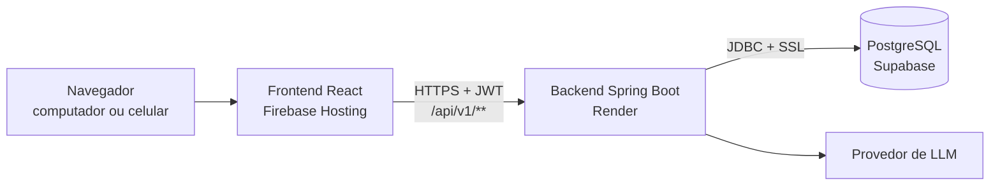
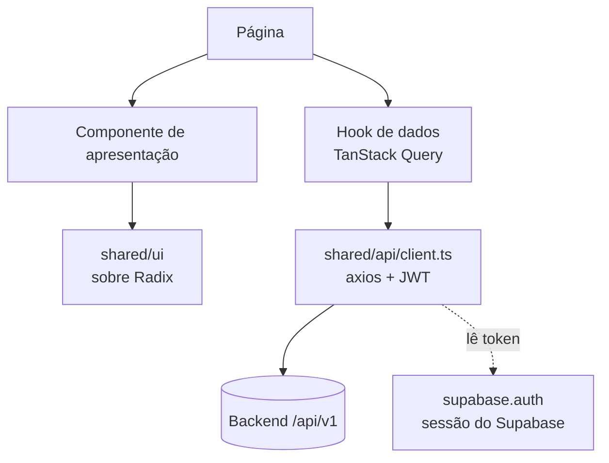
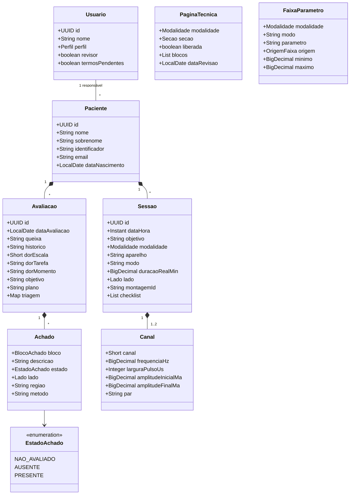
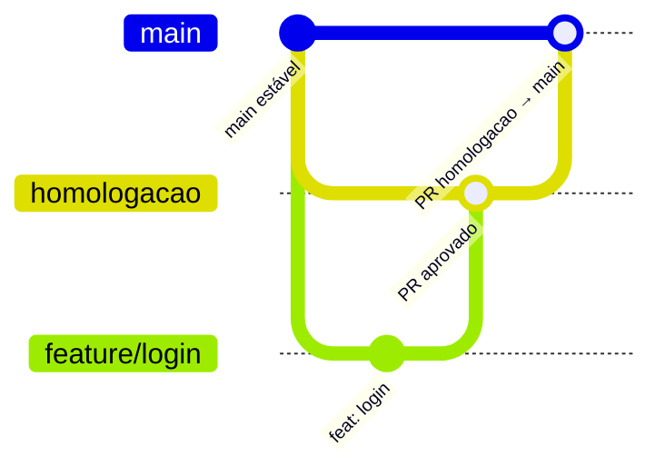

# Fisiotech — Frontend (Web)

SPA da plataforma educacional e clínica de eletroestimulação **Fisiotech** (TENS, NMES e FES). Este repositório tem duas pastas:

- `frontend/` (este documento): React 19 + TypeScript + Vite.
- `backend/`: API em Java 25 + Spring Boot. Veja `../backend/README.md`.

O frontend **nunca** fala direto com o banco. Todo dado passa pela API do backend (`/api/v1/**`). As regras de acesso valem no backend; aqui elas só escondem a interface.

Documentos de origem (fora deste repositório, pasta `docs/` do projeto): `Prototipo_TENS_FES_Revisado.md`, `Guia_Tecnico_Implementacao_TENS_FES.md`, `uml_e_arquitetura_do_sistema_front_end_back_end.md` e `trello_cards.md`.

---

## Sumário

1. [Stack](#1-stack)
2. [Pré-requisitos](#2-pré-requisitos)
3. [Como rodar localmente](#3-como-rodar-localmente)
4. [Variáveis de ambiente](#4-variáveis-de-ambiente)
5. [Comandos](#5-comandos)
6. [Arquitetura](#6-arquitetura)
7. [Estrutura de pastas](#7-estrutura-de-pastas)
8. [Autenticação no frontend](#8-autenticação-no-frontend)
9. [Perfis e regras de acesso](#9-perfis-e-regras-de-acesso)
10. [Mapa de telas](#10-mapa-de-telas)
11. [UML — domínio](#11-uml--domínio)
12. [UML — sequência: registrar sessão](#12-uml--sequência-registrar-sessão)
13. [Acessibilidade](#13-acessibilidade)
14. [Convenções de código](#14-convenções-de-código)
15. [Testes](#15-testes)
16. [Branches, commits e Pull Requests](#16-branches-commits-e-pull-requests)
17. [Deploy](#17-deploy)
18. [Estado atual e pendências](#18-estado-atual-e-pendências)

---

## 1. Stack

| Camada | Tecnologia | Motivo |
|---|---|---|
| UI | React 19 + TypeScript 6 | Tipagem forte |
| Build / dev server | Vite 8 | Rápido, HMR |
| Rotas | React Router 8 (`react-router`) | Rotas protegidas por perfil |
| Dados remotos | TanStack Query + axios | Cache, loading e erro sem código repetido |
| Formulários | React Hook Form + Zod 4 | Validação declarativa; mensagens acessíveis |
| Login e sessão | `@supabase/supabase-js` (só `supabase.auth.*`) | Identidade no Supabase Auth; dados sempre pela API |
| Visual | CSS próprio com tokens (`src/styles`) e fontes auto-hospedadas (`@fontsource`: Big Shoulders Display, Ubuntu, Ubuntu Mono) | Identidade do protótipo; sem Google Fonts, por causa da CSP e da LGPD |
| Componentes base | Radix UI (`radix-ui`): diálogo, menu da conta, grupo de rádio e chave | Foco, teclado e ARIA corretos por padrão |
| Markdown do conteúdo técnico | `react-markdown` + `remark-gfm`, sem HTML cru (`features/modulo/CorpoMarkdown.tsx`) | Texto da API exibido sem executar script; tabelas do guia |
| Gráficos do simulador | SVG próprio, animado com `requestAnimationFrame` | Sem biblioteca de gráfico; tabela e descrição textual equivalentes |
| Aparelho 3D | react-three-fiber *(a adicionar, card próprio)* | Hoje: desenho do painel + lista textual de controles |
| Tipos da API | `openapi-typescript` | Gerados do contrato do backend |
| Lint | oxlint com plugin `jsx-a11y` | Lint rápido + regras de acessibilidade |
| Testes | Vitest + Testing Library + jsdom; `vitest-axe`; Playwright + `@axe-core/playwright` | Unitário, componente, a11y, e2e |
| Deploy | Firebase Hosting (Spark) | Guia em [DEPLOY.md](../DEPLOY.md) |

> A doc de arquitetura cita ESLint + `eslint-plugin-jsx-a11y`. O template atual do Vite traz **oxlint**, que tem o mesmo conjunto de regras `jsx-a11y`. Ficamos com o oxlint para não manter dois linters.

---

## 2. Pré-requisitos

| Ferramenta | Versão |
|---|---|
| Node.js | 24 LTS ou mais novo |
| npm | 11+ (vem com o Node) |
| Backend rodando | para telas que chamam a API (ver `../backend/README.md`) |

```powershell
node -v
npm -v
```

---

## 3. Como rodar localmente

```powershell
git clone git@github.com:eksdat/tens-fes-web.git
cd tens-fes-web
git switch homologacao
cd frontend

npm install
npm run dev
```

Abra http://localhost:5173. `npm run dev` já aponta para o **backend e o Supabase locais** (`.env.development`, valores públicos). Suba os dois antes, como em "Rodar com o Supabase local" no [README do backend](../backend/README.md): `npx supabase start` na raiz e o backend com o perfil `local`. O e-mail de confirmação do cadastro sai pelo SMTP configurado em `supabase/.env` (ou cai no Mailpit, http://127.0.0.1:54324, se o SMTP estiver desligado).

Para usar a nuvem no `npm run dev`, crie `.env.development.local` (ignorado pelo git) com `VITE_API_URL`, `VITE_SUPABASE_URL` e `VITE_SUPABASE_PUBLISHABLE_KEY` reais (modelo em `.env.example`).

- Sem login, qualquer rota protegida redireciona para `/login`.
- O backend precisa liberar a origem `http://localhost:5173` em `CORS_ALLOWED_ORIGINS` (já é o padrão).

---

## 4. Variáveis de ambiente

`npm run dev` lê `.env.development` (versionado, só valores locais públicos) e `.env.development.local` (sobrescreve, ignorado pelo git). O build de produção lê `.env.production.local` (ignorado; ver [DEPLOY.md](../DEPLOY.md)). O `.env.example` é o modelo para a nuvem.

| Variável | Obrigatória | Exemplo | Uso |
|---|---|---|---|
| `VITE_API_URL` | sim | `http://localhost:8080` | URL base do backend, sem `/api/v1` |
| `VITE_SUPABASE_URL` | sim | `http://127.0.0.1:54321` | URL do Supabase (local no `dev`) |
| `VITE_SUPABASE_PUBLISHABLE_KEY` | sim | `sb_publishable_...` | Chave publicável. Nunca a secret/service_role |
| `VITE_TURNSTILE_SITE_KEY` | não | `0x4AAAA...` | Site Key do CAPTCHA (Cloudflare Turnstile). Vazia: sem CAPTCHA. No `npm run dev` vai a chave de teste, que sempre aprova |

Toda variável com prefixo `VITE_` vai para o bundle e **fica pública** no navegador. Nunca coloque segredo aqui. A chave publicável do Supabase é pública por desenho; a secret/service_role nunca entra no frontend.

---

## 5. Comandos

| Comando | O que faz |
|---|---|
| `npm run dev` | Servidor de desenvolvimento em `:5173` |
| `npm run build` | Checagem de tipos (`tsc -b`) + build em `dist/` |
| `npm run preview` | Serve o `dist/` para conferir o build |
| `npm run lint` | oxlint (inclui regras de acessibilidade) |
| `npm test` | Vitest, uma execução |
| `npx vitest` | Vitest em modo watch |
| `npx playwright install chromium` | Uma vez por máquina: baixa o navegador dos testes ponta a ponta |
| `npm run e2e` | Testes ponta a ponta (Playwright) no build de produção, sem backend e sem Supabase |
| `npx playwright test --ui` | Os mesmos testes com a janela do Playwright, passo a passo |
| `npm run api:types` | Gera `src/shared/api/schema.d.ts` a partir de `http://localhost:8080/v3/api-docs` (backend precisa estar rodando) |

---

## 6. Arquitetura

Visão do sistema inteiro:



Plataforma: uma versão web responsiva (computador e navegador do celular). Não há aplicativo nativo.

**Supabase:** o frontend usa só o **Supabase Auth** (`supabase.auth.*`) para identidade: cadastro, login, Google, MFA. Todo dado passa pela API do backend; nunca `from()`, `rpc()`, `storage` ou `realtime`. A regra "profissional só vê o próprio paciente" fica num lugar só, o backend.

### Organização por feature

Cada feature tem suas páginas, componentes, hooks de dados e schemas juntos. O que é usado por várias features fica em `shared/`.

- `shared` não importa de `features`; feature não importa de outra feature; quem compõe várias fica em `app/`.
- Teste em `tests/`, no mesmo caminho do arquivo testado, com o alias `@/` para `src/`; helper de render em `tests/renderComRotas.tsx`.

| Peça | Papel | Pode | Não pode |
|---|---|---|---|
| Página (container) | Busca dados por hook e orquestra componentes | Usar hooks de dados | — |
| Componente de apresentação | Recebe `props`, dispara callbacks | Ter estado de UI | Chamar HTTP |
| Funções de API e hooks (`features/*/api.ts`, `usePaginaTecnica`, `useFaixas`) | Chamam `api` e são usadas com `useQuery` | Chamar `api` | Renderizar |
| Cliente API (`shared/api/client.ts`) | Instância axios com JWT e tratamento de 401 | — | Ter regra de negócio |
| Schema Zod (`schemas.ts`) | Validação do formulário | — | — |
| Tipos | Gerados do OpenAPI (`schema.d.ts`) | — | Ser escritos à mão *(hoje há tipos à mão em `features/*/api.ts`; ver seção 18)* |



---

## 7. Estrutura de pastas

```text
frontend/
├── index.html, package.json, vite.config.ts (alias @/ e config do Vitest)
├── playwright.config.ts         # testes ponta a ponta: build com endereços falsos, computador e celular (360 px)
├── firebase.json, .firebaserc   # Firebase Hosting (ver DEPLOY.md)
├── docs/design-system/          # guia visual e capturas
├── public/favicon.svg
├── src/
│   ├── main.tsx                 # fontes, estilos, preferências de acessibilidade, Providers + Router
│   ├── styles/                  # tokens.css, base.css, ui.css (classes tf-*)
│   ├── app/
│   │   ├── router.tsx           # todas as rotas e o título de cada uma
│   │   ├── ProtectedRoute.tsx   # sessão, cadastro, termos, perfil e MFA
│   │   ├── LayoutLogado.tsx     # menu + <main>; envolve o EstadoDoAparelhoProvider
│   │   ├── MenuPrincipal.tsx, abas.ts, BuscaRapida.tsx, atalhos.ts
│   │   ├── RaizApp.tsx          # "Pular para o conteúdo", document.title e anúncio da página
│   │   └── EmConstrucao.tsx     # só "Criar conteúdo" ainda usa
│   ├── shared/
│   │   ├── api/                 # supabase.ts (só auth), client.ts (axios + JWT), schema.d.ts (gerado)
│   │   ├── auth/                # AuthProvider, useAuth, "Manter conectado"
│   │   ├── acessibilidade/      # BotaoAcessibilidade (flutuante) e preferencias.ts
│   │   └── ui/                  # Alerta, Botao, Campo, CampoSelecao, CampoSenha, CampoTextoLongo, Dialogo,
│   │                            # ErroDeCampo, EtapaProgresso, PerguntasFrequentes, AuthLayout, Marca, Icones...
│   └── features/
│       ├── auth/                # login, cadastro, senha, captcha
│       ├── mfa/, termos/        # termos inclui AceitarTermosPage (novo aceite)
│       ├── usuario/             # useUsuarioAtual, cadastro, perfil profissional, aceitarTermos
│       ├── inicio/, perfil/
│       ├── modulo/              # TENS e FES: layout, 6 abas, PaginaTecnica, usePaginaTecnica, CorpoMarkdown
│       ├── tens/, fes/, casos/  # conteúdo de cada módulo (texto do guia)
│       ├── aparelho/            # PainelDoAparelho, conteudoAparelho, estado compartilhado com o simulador, valores.ts
│       ├── atlas/               # AtlasEletrodos, montagens.ts (pranchas), placa anatômica SVG
│       ├── seguranca/           # ChecklistSeguranca, conteudoSeguranca (itens com código fixo)
│       ├── simulador/           # SimuladorPage, GraficoPulso, OsciloscopioAoVivo, calculos.ts, tracado.ts, useFaixas
│       ├── pacientes/           # PacientesPage, PacienteFormPage, api.ts, formatar.ts, AvisoDadosFicticios
│       ├── avaliacao/           # AvaliacaoFormPage, AvaliacoesDoPaciente, api.ts
│       └── sessao/              # SessaoFormPage, SessoesDoPaciente, AvisoTriagem, api.ts
├── tests/                       # espelha src/ (alias @/); setup.ts, renderComRotas.tsx
└── e2e/                         # testes ponta a ponta; apoio/ tem o Supabase e a API falsos e os dados fictícios
```

Regras de cada módulo (o que faz, regras de negócio, erros comuns) ficam em `agent_docs/modulos/` do vault: `pacientes.md`, `avaliacao.md`, `sessao.md`, `simulador.md`, `atlas-eletrodos.md`, `modulos-tens-fes.md`. Este README só aponta os caminhos.

### Identidade visual

O guia completo (tokens, componentes, padrões, capturas e protótipo) está em [docs/design-system/README.md](docs/design-system/README.md). Leia antes de criar ou alterar uma tela.

---

## 8. Autenticação no frontend

1. O cliente `@supabase/supabase-js` (`shared/api/supabase.ts`) usa só `VITE_SUPABASE_URL` e `VITE_SUPABASE_PUBLISHABLE_KEY`, e **só** em `supabase.auth.*`. Nunca `from()`, `rpc()`, `storage` ou `realtime`.
2. **Login:** `signInWithPassword`. Credencial errada mostra "E-mail ou senha incorretos." (sem dizer qual). E-mail não confirmado oferece reenviar o link (`auth.resend`).
3. **"Manter conectado":** marcado, a sessão fica no `localStorage`; desmarcado (padrão), no `sessionStorage` (some ao fechar a aba). Ver `shared/auth/armazenamento.ts`.
4. **Esqueci a senha:** `resetPasswordForEmail`, com a mesma mensagem exista ou não a conta. O link abre `/nova-senha`, que usa a sessão temporária de recuperação (`updateUser`).
5. **Link de confirmação do e-mail** abre `/auth/callback`: o supabase-js abre a sessão e a rota protegida decide o resto.
6. `client.ts` envia `Authorization: Bearer <access_token>` da sessão atual (renovada pelo SDK).
7. O **perfil** vem de `GET /api/v1/usuarios/me` (`useUsuarioAtual`, TanStack Query), nunca do token nem do `localStorage`.
8. **401** da API: encerra a sessão, e a rota protegida leva ao login. **403**: perfil sem permissão (mensagem, sem deslogar). **404** em paciente: "não encontrado", nunca "sem permissão".
9. Se a API não responde (por exemplo, o servidor do plano grátis ainda subindo, cerca de 3 min), a rota protegida mostra "Não foi possível carregar seus dados" com "Tentar de novo".

`ProtectedRoute` decide só a navegação, nesta ordem: sem sessão vai para `/login`; sem cadastro completo, para `/completar-cadastro`; perfil errado, para `/`; **termos com versão nova** (`termosPendentes` da API), para `/termos/aceitar`; autenticador cadastrado e sessão `aal1`, para `/mfa/verificar`; PROFISSIONAL sem autenticador, para `/mfa/ativar`. As telas de MFA e de aceite usam `semMfa` para não entrar em laço.

---

## 9. Perfis e regras de acesso

| Área | Estudante | Profissional |
|---|---|---|
| Conteúdos TENS/FES, biblioteca, atlas, aparelho | Consulta | Consulta |
| Simulador e casos fictícios | Acesso | Acesso |
| Criar materiais | Rascunho e envio | Contribuição para revisão |
| Pacientes / prontuário | **Sem acesso** | **Só os pacientes sob sua responsabilidade** |
| Casos para a IA | Envia caso fictício | Conteúdo revisado alimenta a base |

Regras que o frontend precisa respeitar:

- Esconder menus e rotas que o perfil não usa. Isso é conforto, não segurança.
- Paciente não é usuário: não existe tela de login de paciente.
- Registro profissional digitado **não** mostra selo de "verificado".
- A API de pacientes, avaliações e sessões exige PROFISSIONAL com sessão `aal2`: o frontend força o MFA antes, para a pessoa não cair em 403.
- Paciente de outro profissional aparece como "não encontrado" (404), nunca como "sem permissão".
- Anexo *(quando existir)*: só PDF e imagem, até 10 MB. Validar antes do upload; o backend valida de novo.
- "Esqueci a senha": mesma mensagem exista ou não a conta.
- Até as políticas LGPD estarem definidas: **somente dados fictícios**.

---

## 10. Mapa de telas

| Rota | Perfil | Página | Observações |
|---|---|---|---|
| `/login`, `/cadastro` | público | `LoginPage`, `CadastroPage` | Cadastro em etapas; "Continuar com o Google" nos dois |
| `/esqueci-senha`, `/nova-senha`, `/auth/callback` | público | telas de senha e retorno do link | Mesma mensagem exista ou não a conta |
| `/termos`, `/privacidade` | público | `TermosDeUsoPage`, `PoliticaPrivacidadePage` | Texto preliminar |
| `/completar-cadastro` | logado sem perfil | `CompletarCadastroPage` | Envia sozinha os dados guardados; senão mostra o formulário |
| `/mfa/ativar`, `/mfa/verificar` | logado | `AtivarMfaPage`, `VerificarMfaPage` | Ativar é obrigatório para PROFISSIONAL |
| `/termos/aceitar` | logado | `AceitarTermosPage` | Novo aceite quando a versão dos termos muda |
| `/` | ambos | `InicioPage` | Módulos, ferramentas (Simulador) e atalhos |
| `/tens`, `/fes` e as abas `aparelho`, `eletrodos`, `parametros`, `seguranca`, `casos` | ambos | `ModuloLayout` + `Pagina*` | Visão geral vem da API (página padrão); atlas em Eletrodos; checklist em Segurança; lista de controles em Aparelho |
| `/simulador` | ambos | `SimuladorPage` | Modo explorar; `?modalidade=TENS|FES&modo=` abre direto num modo |
| `/perfil` | ambos | `PerfilPage` | Troca de estudante para profissional |
| `/criar-conteudo` | ambos | `EmConstrucao` | Card próprio, ainda não feito |
| `/pacientes` | profissional | `PacientesPage` | Busca, ordenação por coluna, paginação; aviso de dados fictícios |
| `/pacientes/novo`, `/pacientes/:id` | profissional | `PacienteFormPage` | Cadastro e edição; no detalhe, listas de avaliações e sessões e exclusão confirmada |
| `/pacientes/:id/avaliacoes/nova`, `/pacientes/:id/avaliacoes/:avaliacaoId` | profissional | `AvaliacaoFormPage` | Avaliação inicial e reavaliação |
| `/pacientes/:id/sessoes/nova` | profissional | `SessaoFormPage` | Formulário, revisão antes de salvar, confirmação |

Qualquer outra rota leva a `/`. Ainda não existem: dicionário em tela própria, biblioteca, revisão de conteúdo, casos para a IA, evolução e relatório do paciente.

---

## 11. UML — domínio

O frontend consome estas entidades pela API, sempre como DTO. O diagrama mostra o que **existe hoje**; o domínio completo planejado (conteúdo editorial, IA, materiais) está no documento de arquitetura do projeto.



O que muda na tela por causa do modelo:

- Triagem e achados usam `EstadoAchado`, com "Não avaliado" como padrão. Campo vazio nunca vira "ausente"; dor vazia fica nula.
- Parâmetros da sessão mostram a unidade ao lado (Hz, µs, mA, min) e por extenso no rótulo.
- O checklist da sessão guarda o **código** do item (`antes.objetivo-definido`); o texto da pergunta vive em `conteudoSeguranca.ts`.
- `montagemId` aponta para uma prancha de `features/atlas/montagens.ts` (as pranchas vivem no frontend).
- Pranchas, controles do aparelho, casos e checklist são dados do frontend, não da API.

---

## 12. UML — sequência: registrar sessão

```mermaid
sequenceDiagram
    autonumber
    actor P as Profissional
    participant UI as SessaoFormPage
    participant Api as axios + JWT
    participant Sec as Spring Security
    participant C as SessaoController
    participant S as SessaoService
    participant PS as PacienteService
    participant DB as PostgreSQL

    P->>UI: Preenche os 6 blocos
    UI->>UI: Validação Zod; erro aparece no campo
    P->>UI: "Revisar sessão"
    UI-->>P: Tela "Revise antes de salvar"
    P->>UI: "Salvar sessão"
    UI->>Api: POST /api/v1/pacientes/{id}/sessoes
    Api->>Sec: Bearer JWT
    Sec->>C: PROFISSIONAL com aal2
    C->>C: @Valid SessaoRequest
    C->>S: registrar(pacienteId, responsavel, req)
    S->>PS: buscarDoResponsavel(pacienteId, responsavel)
    alt paciente de outro profissional ou inexistente
        PS-->>UI: 404 ProblemDetail
    else é o responsável
        S->>DB: INSERT sessao, sessao_canal, sessao_checklist
        S-->>UI: 201 SessaoResponse
        UI->>UI: invalida ["pacientes", id, "sessoes"]
        UI-->>P: "Sessão registrada." num output que o leitor de tela anuncia
    end
```

Chaves do TanStack Query: `["pacientes", filtro]`, `["pacientes", id]`, `["pacientes", id, "avaliacoes"]`, `["pacientes", id, "sessoes"]`. Mutation invalida a chave do recurso que mudou. Ao excluir, o paciente sai do cache (`removeQueries`) antes de navegar, para não rebuscar um 404.

---

## 13. Acessibilidade

Meta: **WCAG 2.2 AA**. Testes automáticos com `vitest-axe`; teste com leitor de tela real ainda pendente.

- Erro de formulário ligado ao campo (`aria-describedby`, `aria-invalid`); o foco vai ao primeiro campo com erro.
- Anúncios: região viva montada vazia desde o início (`<output>`), só o texto muda. O simulador anuncia o valor confirmado ao sair do campo, com as "Mensagens prontas" do guia; a sessão anuncia "Sessão registrada."; excluir mostra "Excluindo o paciente. Aguarde…".
- `Alerta` só usa `role="alert"` no perigo; os demais não interrompem o leitor de tela.
- Lista textual dos controles do aparelho com unidade e valor atual; ao fechar a explicação (botão ou Esc) o foco volta ao controle.
- Gráficos têm descrição textual e tabela equivalentes; os desenhos são `aria-hidden`.
- **Reduzir movimento** segue só o painel de acessibilidade (`data-movimento`), que parte da preferência do sistema. No simulador, a animação fica parada e aparece "Animar mesmo assim".
- Cor nunca é a única pista: canais do atlas e do osciloscópio têm código ou rótulo escrito.
- Botão de acessibilidade flutuante (tamanho do texto, alto contraste, reduzir movimento), presente em todas as telas.

---

## 14. Convenções de código

- Nomes em **português** do domínio (`entrar`, `sair`, `Sessao`, `usePacientes`). Termos de biblioteca ficam como são.
- Componente: `PascalCase.tsx`. Hook: `useAlgo.ts`. Teste em `tests/`, no mesmo caminho do arquivo testado (`Algo.test.tsx`), com o alias `@/` para `src/`.
- Exportação nomeada. Sem `export default` (exceto config de ferramenta).
- Componente de apresentação não chama HTTP.
- Não escreva tipo de DTO à mão: use `schema.d.ts` gerado.
- Comentário só explica **por quê**. Nada de código comentado ou `TODO` sem dono.
- Solução mais simples para o problema de hoje. Sem abstração "para o futuro".

---

## 15. Testes

| Tipo | Ferramenta | Onde |
|---|---|---|
| Unitário / componente | Vitest + Testing Library + jsdom | `tests/**/*.test.tsx` |
| Acessibilidade automática | `vitest-axe` | nos testes de componente |
| End-to-end | Playwright + `@axe-core/playwright` | `e2e/*.spec.ts` |

Regras:

- **TDD**: bug novo começa com teste que falha. Regra nova começa pelo teste.
- Nome descreve comportamento: `deveRedirecionarEstudanteQueTentaAbrirPacientes`.
- Teste o que o usuário vê (texto, papel, label), não detalhe interno.
- Sem dependência de ordem, relógio real ou rede. Chamadas HTTP mockadas.
- `tests/setup.ts` limpa o DOM e o `localStorage` depois de cada teste.

Hoje: 44 arquivos de teste, cerca de 560 testes (`npm test`). Cálculos do simulador e máscaras têm testes de função pura (`tests/features/simulador/tracado.test.ts`, `calculos.test.ts`, `pacientes/formatar.test.ts`).

### Testes ponta a ponta

Abrem o site num Chromium de verdade e fazem o caminho que a pessoa faz, do login até salvar. Não precisam de
backend, Supabase nem `.env`:

- O `playwright.config.ts` gera um build com `VITE_API_URL` e `VITE_SUPABASE_URL` apontando para endereços que não
  existem (`e2e/apoio/enderecos.ts`) e serve esse build na porta 4180.
- `e2e/apoio/supabaseFalso.ts` responde o Supabase Auth (login, cadastro, link do e-mail, código do autenticador) e
  `e2e/apoio/apiFalsa.ts` responde a API com as mesmas regras de acesso do backend (`/pacientes/**` só para
  PROFISSIONAL). Tudo em memória: cada teste começa do zero.
- Contas são as personas do grupo (Sininho, Peter Pan e Capitão Gancho) e os pacientes são fictícios
  (`e2e/apoio/dados.ts`).
- O teste falha se a tela fizer uma chamada que os falsos não conhecem ou se der erro de JavaScript.
- Cada teste roda duas vezes: computador e celular com 360 px de largura (definição de pronto).

| Arquivo | Fluxos |
|---|---|
| `acesso.spec.ts` | Rota protegida, senha errada, login do estudante, estudante fora de Pacientes, recarregar, sair |
| `cadastro.spec.ts` | Criar conta, link de confirmação, completar cadastro, e-mail não confirmado, aceite dos termos |
| `estudo.spec.ts` | Conteúdo pendente e aprovado, abas de TENS e FES, atlas, parâmetros → simulador, limite do aparelho |
| `profissional.spec.ts` | Código do autenticador, paciente → avaliação → sessão com checklist, identificador repetido, busca |
| `acessibilidade.spec.ts` | Uso só com teclado, "Pular para o conteúdo" e axe (WCAG 2.2 AA) nas telas principais |

No CI, o job "Testes ponta a ponta" do `frontend.yml` roda em todo PR. Se falhar, o relatório fica nos artefatos da
execução (`relatorio-ponta-a-ponta`); abra com `npx playwright show-report <pasta>`.

---

## 16. Branches, commits e Pull Requests



| Branch | Papel | Quem escreve |
|---|---|---|
| `main` | Produção. Sempre estável | Só por PR vindo de `homologacao` |
| `homologacao` | Integração e teste antes da produção | Só por PR vindo de `feature/*` ou `fix/*` |
| `feature/<descricao>` | Funcionalidade nova. Sai de `homologacao` | Autor |
| `fix/<descricao>` | Correção. Sai de `homologacao` | Autor |
| `hotfix/<descricao>` | Correção urgente em produção. Sai de `main`, volta para `main` **e** `homologacao` | Autor |

Fluxo:

1. `git switch homologacao && git pull`
2. `git switch -c feature/tela-login`
3. Commits pequenos. Rode `npm run lint`, `npm test` e `npm run build`.
4. Push e PR para `homologacao`.
5. **O outro dev revisa e aprova.** Ninguém aprova o próprio PR.
6. CI verde + aprovação: merge em `homologacao`.
7. Validado em homologação: PR `homologacao` → `main`, também com aprovação do outro dev.

Proibido: push direto em `main` ou `homologacao`, `push --force` nessas duas, merge com CI vermelho.

Commits: uma linha, imperativo, prefixo [Conventional Commits](https://www.conventionalcommits.org/pt-br/):

```
feat: adiciona tela de login com validação acessível
fix: redireciona para login após 401
docs: explica variáveis de ambiente no README
test: cobre ProtectedRoute por perfil
chore: atualiza vite para 8.3
```

Sem linha de coautoria nem assinatura de ferramenta.

---

## 17. Deploy

Frontend no **Firebase Hosting** (plano Spark). Só existe o ambiente de produção; a branch `homologacao` é etapa de revisão no git.

- `frontend/firebase.json`: publica `dist`, devolve `index.html` para toda rota (SPA), define a CSP e os demais cabeçalhos de segurança e roda `npm run build` antes do deploy.
- `frontend/.firebaserc` (no repositório) liga a pasta ao projeto Firebase.
- Build de produção lê `frontend/.env.production.local` (API, Supabase). Nunca no commit.
- Deploy manual: `firebase deploy --only hosting`. Passo a passo e conferência em **[DEPLOY.md](../DEPLOY.md)**.
- **Não rodar `firebase init`**: ele regrava o `firebase.json` e apaga a CSP, os cabeçalhos, o `predeploy` e o cache (`git restore frontend/firebase.json` desfaz). Armadilhas em [DEPLOY.md](../DEPLOY.md), seção 3.
- CORS: o backend (Render) precisa listar a URL do site em `CORS_ALLOWED_ORIGINS`.
- CSP estrita (`script-src 'self'`): ao incluir o CAPTCHA (Turnstile) ou uma biblioteca que injete estilo, ajustar o `frontend/firebase.json`.
- CI de frontend (GitHub Actions): ainda não criado.

---
## 18. Estado atual e pendências

Pronto (ver `agent_docs/modulos/` para o detalhe de cada um):

- Autenticação completa: senha, Google, MFA (obrigatório para PROFISSIONAL), "Manter conectado", novo aceite dos termos.
- Módulos TENS e FES com 6 abas: Visão geral pela API (página padrão, Markdown seguro), lista de controles do aparelho, atlas com pranchas, parâmetros, checklist de segurança e casos.
- Simulador (modo explorar): osciloscópio ao vivo com câmera lenta, modos contínuos, Burst e FES síncrono/recíproco, mensagens do guia.
- Pacientes, avaliação inicial e registro de sessão, com validação no formulário e no backend.
- Acessibilidade: botão flutuante, anúncios, `vitest-axe` nos testes de tela.
- Testes ponta a ponta (Playwright) dos fluxos principais, no computador e no celular, rodando em todo PR.

Pendente:

- Revisão docente dos textos (prof. Taís): o site mostra "Revisão docente: pendente" e a Visão geral fica "não liberada" até o conteúdo ser aprovado no banco.
- Simulador: modos Misto, VF e VIF (variação automática) e o modo praticar.
- Lista do aparelho só mostra valores; quem ajusta é o simulador. O estado some ao recarregar a página.
- Tipos de pacientes, avaliação, sessão, simulador e página técnica escritos à mão em `features/*/api.ts`: rodar `npm run api:types` com o backend no ar e trocar pelos tipos gerados.
- Criar conteúdo, revisão, biblioteca, dicionário em tela própria, casos para a IA, evolução e relatório do paciente.
- Revisão jurídica/LGPD dos Termos e da Política (texto preliminar).
- Teste com leitor de tela real (NVDA e TalkBack).
- `openapi-typescript` roda por `npx` (pede TypeScript 5).
